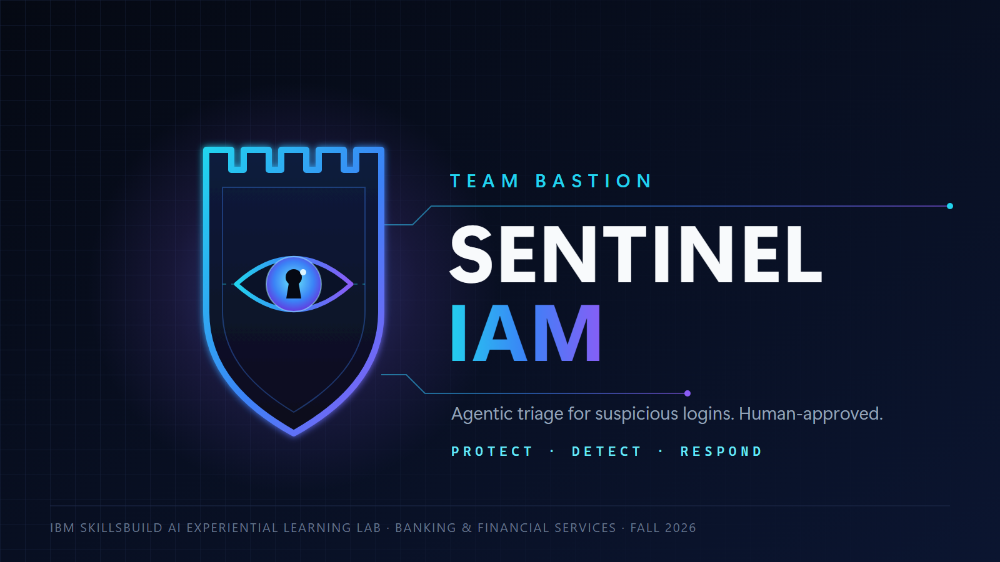

<p align="center"></p>

# Sentinel IAM

**One AI agent that helps a bank's security analyst handle a suspicious login in about a minute instead of about an hour. A human approves every action.**

Team Bastion · IBM SkillsBuild AI Experiential Learning Lab (Fall 2026) · Banking & Financial Services track
Built with **IBM Bob** · Runs on **watsonx Orchestrate**

> **New here? Open the [Team Guide](docs/guides/00-team-guide.docx) first, then the guide for your role below.**
> **Reviewing the project?** Jump to [For reviewers](#for-reviewers-a-5-minute-tour).

---

## Project guides (Word documents)

| Guide | For |
|---|---|
| [00 Team Guide](docs/guides/00-team-guide.docx) | Everyone: overview, status, onboarding, roles, timeline |
| [01 Setup and Coding Standards](docs/guides/01-setup-and-coding-standards.docx) | Everyone: machine setup, Bob rules, Python style, commits |
| [02 Backend Guide](docs/guides/02-backend-guide.docx) | Technical Support / QA: CyberShield_IV, Tasks 03 and 03b |
| [03 Tools Guide](docs/guides/03-tools-guide.docx) | Technical Support / QA: OpenAPI spec, Orchestrate import (Task 04) |
| [04 Agent Guide](docs/guides/04-agent-guide.docx) | Technical Lead: agent, knowledge base (Tasks 05, 05b) |
| [05 Frontend Guide](docs/guides/05-frontend-guide.docx) | Technical Lead, Communications & Demo Lead: chat layout, audit record, demo |
| [06 Testing and Troubleshooting](docs/guides/06-testing-and-troubleshooting.docx) | Technical Support / QA: test commands, pass bar, fixes (Task 06) |

---

## The project in 60 seconds

**The problem.** When a bank sees a suspicious login, an analyst has to check several things by hand: Is this user's location normal? Is this device known? Is the IP on a threat list? Is there an active attack campaign? An alert waits about 55 minutes before someone picks it up, and a full investigation takes about 75 minutes. Attackers need about 29 minutes. ([sources](docs/research/research-evidence.md))

**Our solution.** **Sentinel** is one AI agent. You give it a login alert. It:

1. decides which tools to call to gather evidence,
2. explains the risk in plain language (Low / Medium / High / Critical),
3. ranks the possible responses best to worst, each with a reason,
4. **waits for a human analyst to approve.** Sentinel never takes an action by itself.

```
Login alert ──► Sentinel (AI agent) ──► calls tools as needed ──► verdict + ranked recommendations ──► Analyst approves / rejects
                                         • assess_login                                                 (nothing runs without approval)
                                         • get_live_threats
                                         • analyze_signal
```

Full diagram: [docs/architecture-incident-flow.svg](docs/architecture-incident-flow.svg) · Full explanation: [docs/ARCHITECTURE.md](docs/ARCHITECTURE.md)

---

## Where things stand

As of **Oct 21, 2026**. The live, detailed tracker is [docs/STATUS.md](docs/STATUS.md). Update it when you finish something.

| Piece | State |
|---|---|
| Problem, research, design | ✅ Done |
| `assess_login` tool on the backend (Task 02) | ✅ Built with Bob, tested, live |
| Local Python prototype of the whole agent (`sentinel_iam/`) | ✅ Runs, 21/21 tests pass. Uses an **old** failure rule (see STATUS) |
| Agent instructions and response playbook | ✅ Written, waiting to be loaded into Orchestrate |
| Banking threat feed + 5-minute failure flag (Tasks 03, 03b) | ⬜ Next up |
| Tools and agent in watsonx Orchestrate (Tasks 04, 05, 05b) | ⬜ Not started |
| Full test pass, tag `v1-tested` (Task 06) | ⬜ Not started |
| Analyst interviews, timing, written deliverables, video | ⬜ Not started |

**Next milestones:** Oct 25 checkpoint · Nov 1 `v1-tested` · Nov 8 agent frozen · **Nov 22 submission**.

---

## Try it in 2 minutes

You only need Python 3.10 or newer. On Windows use `py`; on Mac/Linux use `python3`.

```bash
git clone https://github.com/PC-DigitalSolutions/IBM-Sentinel-IAM.git
cd IBM-Sentinel-IAM
py -m pip install pytest
py sample_run.py
py -m pytest tests -q
```

- `sample_run.py` runs the local prototype on one fake alert and prints the risk, the ranked actions, and the approval gate.
- `pytest tests -q` should print **21 passed**.

All data is fictional. IPs come from the documentation ranges `203.0.113.x`, `198.51.100.x`, `192.0.2.x`. Never add real data.

---

## Two repositories, one project

This is the part that confuses people most.

| Repo | What lives there | Link |
|---|---|---|
| **IBM-Sentinel-IAM** (this one) | The agent: instructions, the Bob task prompts, test scenarios, the local prototype, docs, and the graded `bob_sessions/` folder | github.com/PC-DigitalSolutions/IBM-Sentinel-IAM |
| **CyberShield_IV** | The backend the agent calls: a FastAPI service with the real `/iam/assess-login`, `/threats/live` and `/analyze` endpoints. Live at `https://cybershield-iv.onrender.com` | github.com/PC-DigitalSolutions/CyberShield_IV |

Tasks 02, 03 and 03b change **CyberShield_IV**. Tasks 04 to 06 happen in **this repo** and in watsonx Orchestrate.

---

## Repo map

```
sentinel-iam/
├── README.md               ← you are here
├── CONTRIBUTING.md         ← how we work: Bob rules, evidence, commits, status posts
├── AGENTS.md               ← context file IBM Bob reads automatically. Keep it short and current
├── agents/
│   └── sentinel.instructions.md   ← the agent's "brain": what to paste into Orchestrate
├── tools/                  ← (empty) Task 04 puts the OpenAPI tool spec here
├── sentinel_iam/           ← local Python prototype of the agent (reference + backup demo)
├── sample_run.py           ← runs the prototype once
├── tests/
│   ├── scenarios.json      ← THE definition of done: test alerts A–L and expected results
│   ├── fixtures/iam_baselines.json   ← fake users, cities, threat IPs
│   └── test_assess_login.py           ← prototype unit tests
├── bob_sessions/           ← ⚠️ GRADED: Bob session screenshots from every member
└── docs/
    ├── README.md           ← index of every doc, and which ones are current
    ├── ONBOARDING.md       ← step-by-step for new members
    ├── ARCHITECTURE.md     ← how the pieces fit together
    ├── STATUS.md           ← what's done, what's next, who owns it
    ├── build-spec.md       ← the technical spec (source of truth)
    ├── bob-tasks/          ← one prompt file per Bob session (the build queue)
    ├── orchestrate-runbook.md   ← exact commands for Orchestrate
    ├── knowledge/          ← response playbook (the agent's knowledge base)
    ├── testing/            ← test sheet + timing protocol
    ├── research/           ← sourced statistics + interview guide
    └── team/               ← roles, playbook, Slack handoff history
```

---

## Which document wins?

Some older docs still describe earlier designs (four agents, a 15-minute failure window, a 3-person team). When two docs disagree, trust them in this order:

1. [`docs/build-spec.md`](docs/build-spec.md) and [`agents/sentinel.instructions.md`](agents/sentinel.instructions.md)
2. [`tests/scenarios.json`](tests/scenarios.json) and [`docs/testing/test-sheet.md`](docs/testing/test-sheet.md)
3. [`docs/STATUS.md`](docs/STATUS.md)
4. Everything else. [docs/README.md](docs/README.md) marks which files are historical.

**Settled design rules (don't change without sign-off from Aldo, the project advisor):**
- One agent, three tools, one knowledge base. No extra agents.
- Recommend, never execute. A human approves every action.
- Recommendations are ranked best to worst, each with a reason. No hedging words ("probably", "most likely").
- 2 or more failed logins within **5 minutes** flags the case. (The old 15-minute rule is retired.)
- Fictional data only.

---

## Who does what

| Role | Owns |
|---|---|
| Team Lead / Advisor (Aldo) | Answers questions, signs off on design changes and the final package. Not assigned build tasks |
| Technical Lead | The agent in Orchestrate (Tasks 05, 05b), audit log, agent freeze |
| Technical Support / QA | Threat feed and failure flag (03, 03b), Orchestrate tools (04), test pass (06), timing |
| Research & Documentation Lead | Analyst interviews, white paper, written statements |
| Communications & Demo Lead | Demo script, checkpoint deck, 3-minute video, submission packaging |

Names are recorded in [docs/STATUS.md](docs/STATUS.md#team). Role details: [docs/team/team-playbook.md](docs/team/team-playbook.md).

---

## For reviewers: a 5-minute tour

1. **What and why:** the top of this page, then [docs/build-spec.md](docs/build-spec.md) sections 1 to 3.
2. **The agent's behavior:** [agents/sentinel.instructions.md](agents/sentinel.instructions.md). It defines the goal, the guardrails and the reply format.
3. **How we prove it works:** [tests/scenarios.json](tests/scenarios.json) and [docs/testing/test-sheet.md](docs/testing/test-sheet.md). There are 12 scenarios, from normal logins to account takeover.
4. **Evidence that IBM Bob built it:** [bob_sessions/](bob_sessions/README.md).
5. **Where the numbers come from:** [docs/research/research-evidence.md](docs/research/research-evidence.md).
6. **What's done and what's left:** [docs/STATUS.md](docs/STATUS.md).
