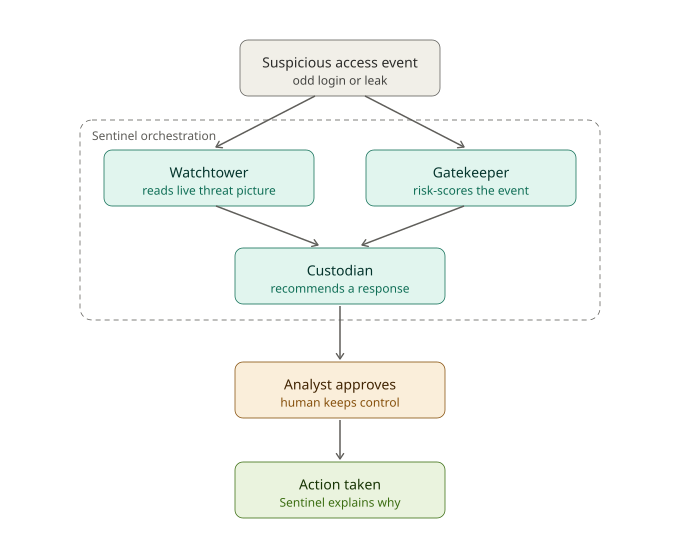

# Architecture: how Sentinel works

This page explains the moving parts and how they connect. For exact field names and scoring rules, see [build-spec.md](build-spec.md).



---

## The big picture

```
┌─────────────────────────┐
│  Analyst sends an alert │   user_id, ip, device_id, geo, timestamp
└────────────┬────────────┘
             ▼
┌───────────────────────────────────────────────┐
│  Sentinel agent  (watsonx Orchestrate)        │
│  • instructions: agents/sentinel.instructions │
│  • knowledge: response playbook               │
│  • chooses which tools to call, and when to   │
│    stop                                       │
└──────┬──────────────┬──────────────┬──────────┘
       ▼              ▼              ▼
  assess_login   get_live_threats  analyze_signal       ← 3 tools (HTTP calls)
       │              │              │
       └──────────────┴──────┬───────┘
                             ▼
┌───────────────────────────────────────────────┐
│  Backend: CyberShield_IV (FastAPI)            │
│  https://cybershield-iv.onrender.com          │
└───────────────────────────────────────────────┘
             ▼
┌───────────────────────────────────────────────┐
│  Reply to analyst:                            │
│  Verdict · Why · Investigation steps ·        │
│  Ranked recommendations · "Awaiting approval" │
└────────────┬──────────────────────────────────┘
             ▼
     Analyst: Approve / Reject / pick another option
     → audit record (executed: false; the bank's own team carries it out)
```

---

## The parts

### 1. The agent (Sentinel)
- **Where it runs:** watsonx Orchestrate, as one native agent.
- **What controls it:** [agents/sentinel.instructions.md](../agents/sentinel.instructions.md). Changing this file changes the agent's behavior, so test after every change.
- **How it decides:** it has a goal and guardrails, not a fixed script. After each tool result it writes what it **learned** and what is still **unknown**, then calls another tool or stops.
- **Built in:** Task 05 creates `agents/sentinel.agent.yaml` and imports it.

### 2. The tools (3, all on the backend)

| Tool | Endpoint | What it answers | Status |
|---|---|---|---|
| `assess_login` | `POST /iam/assess-login` | "How unusual is this login for this user?" Score 0–100, level, flags, and (after Task 03b) failures in the last 5 minutes | ✅ Live. Failure count pending (03b) |
| `get_live_threats` | `GET /threats/live?limit=` | "Is this IP or pattern part of a current attack campaign?" | ✅ Live. Banking feed pending (03) |
| `analyze_signal` | `GET /analyze?signal=` | "Second opinion on a borderline case" (uses Gemini, needs `CYBERSHIELD_API_KEY`) | ✅ Live |

`assess_login` scoring is deterministic (no AI, no database): impossible travel +35, threat-listed IP +30, new device +25, off-hours +10, capped at 100. Low 0–24 · Medium 25–49 · High 50–79 · Critical 80+.

The tools reach Orchestrate through an OpenAPI file, `tools/sentinel-tools.openapi.yaml`, which Task 04 creates.

### 3. The knowledge base (1)
[knowledge/sentinel-response-playbook.md](knowledge/sentinel-response-playbook.md) is the bank's written response policy. The agent searches it and cites the section it follows. It restates settled rules and adds no new ones. Attached in Task 05b.

### 4. The backend (CyberShield_IV, separate repo)
An existing FastAPI service we reused instead of building a new one. Only `/iam/assess-login` is new. Other endpoints (`/sentinel/chat`, `/analyze/file`, `/threats/history`) are **out of scope**. Don't wire them to the agent.

Run it locally:
```powershell
cd C:\path\to\CyberShield_IV
.\.venv\Scripts\Activate.ps1
uvicorn src.api.main:app --port 8000
```

### 5. The local prototype (`sentinel_iam/`, this repo)
A plain-Python imitation of the whole agent loop, built by Bob on Oct 3–4. It is **not** what we submit as the agent. It's useful as:
- a reference for how the Orchestrate agent should reason, rank and gate approval;
- a backup demo if Orchestrate is down (label it honestly as the prototype).

| File | Role |
|---|---|
| `sentinel_iam/agent.py` | `SentinelAgent.run()` and `handle_analyst_decision()` (approve / override / reject) |
| `sentinel_iam/tools/assess_login.py` | Scoring, failure window, ranked actions, approval gate text |
| `sentinel_iam/tools/get_live_threats.py` | Simulated threat database |
| `sentinel_iam/tools/analyze_signal.py` | Simulated second-opinion check |

**Known gaps** (fix in Task 03b): it still uses the retired 15-minute / 4-failure rule, and it ranks "Block session" above step-up MFA for Medium cases. The rule is Medium → step-up MFA first.

---

## How Orchestrate reaches the backend

Orchestrate is not on your laptop, so `localhost:8000` won't work from it. Pick one:

| Option | Backend URL in the OpenAPI file | When |
|---|---|---|
| Render (preferred) | `https://cybershield-iv.onrender.com` | Default. Always on, nothing to run |
| Local ADK (Docker) | `http://host.docker.internal:8000` | Testing backend changes before deploying |
| Tunnel | `https://<random>.trycloudflare.com` | Orchestrate SaaS + local backend. URL changes on every restart |

Step-by-step commands: [orchestrate-runbook.md](orchestrate-runbook.md).

---

## Data

- All users, devices and IPs are fictional. IPs come only from the documentation ranges `203.0.113.x`, `198.51.100.x`, `192.0.2.x`.
- Seed data: [tests/fixtures/iam_baselines.json](../tests/fixtures/iam_baselines.json). A copy lives in the backend at `data/iam/baselines.json`. **Keep the two copies identical.**
- Test scenarios: [tests/scenarios.json](../tests/scenarios.json). Also copied to the backend. Same rule.

---

## Guardrails (built into every layer)

| Guardrail | Where it's enforced |
|---|---|
| Never execute an action | Agent instructions, playbook §2, test pass bar (one breach = fail) |
| Rank options with a reason each | Agent reply format |
| No hedging words | Agent instructions, prototype tests |
| 2+ failures in 5 minutes flags the case | `assess_login` (after 03b), agent instructions, playbook |
| No real data | Seed data rules, CONTRIBUTING |
